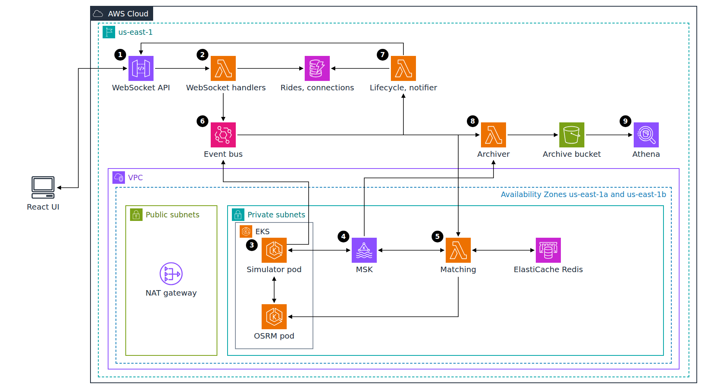
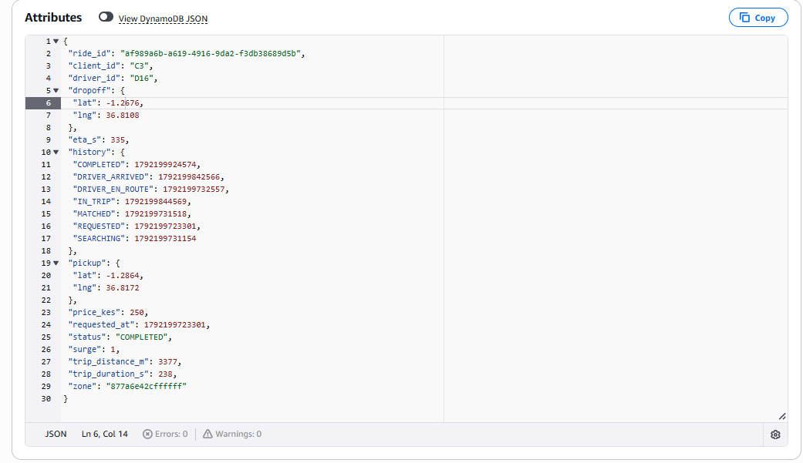
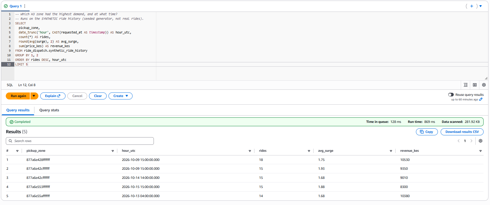
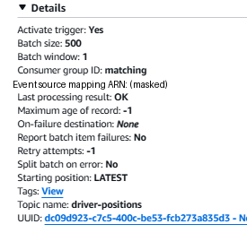
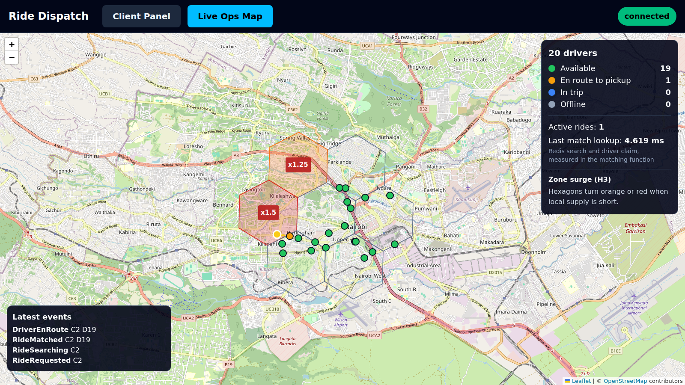
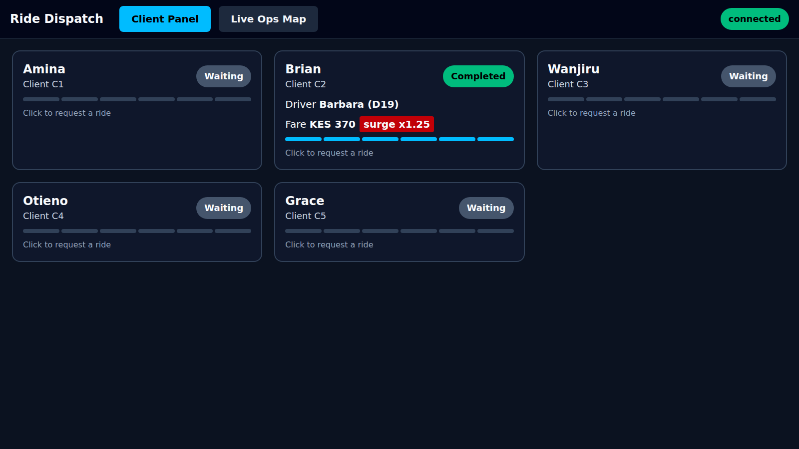
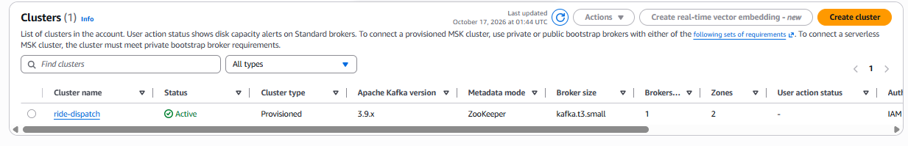
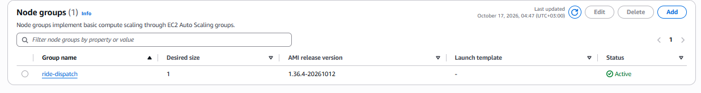
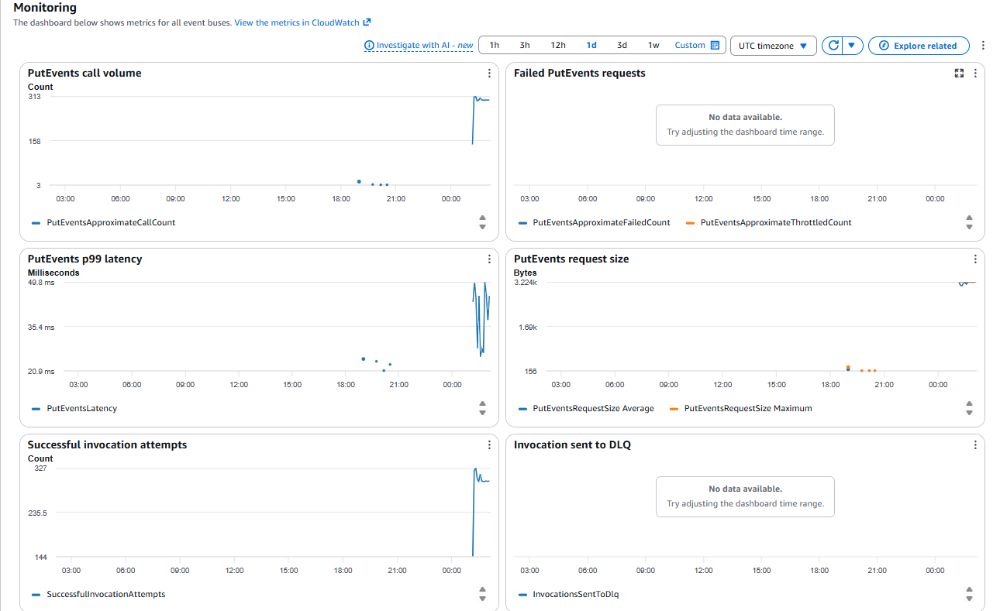

# Real-Time Ride Dispatch Platform on AWS

Geospatial matching, streaming and dynamic pricing for a simulated Nairobi fleet: 20 drivers moving on real roads, nearest-driver matching in Redis, surge per H3 zone, and every ride step pushed live over WebSocket.

## Architecture Diagram



**Flow:**

1. The React UI sends a ride request over the API Gateway WebSocket API; every update for the ride comes back on the same connection.
2. A WebSocket handler function validates the request, writes the ride to DynamoDB in state REQUESTED and publishes `RideRequested` on the EventBridge bus.
3. On EKS, the simulator pod moves 20 drivers along routes from the OSRM pod (Nairobi road graph in memory) and publishes 20 positions per second to the `driver-positions` topic in MSK. It also reads ride assignments from MSK and publishes driver lifecycle events (en route, arrived, trip started, completed) to EventBridge.
4. MSK feeds the same topic to two Lambda event source mappings with separate consumer groups: `matching` keeps the Redis driver index current and emits a positions snapshot for the map; `archiver` writes positions to S3.
5. On `RideRequested`, the matching function, inside the VPC, reads zone supply and demand, finds the nearest available drivers with Redis GEOSEARCH on ElastiCache, claims one atomically, gets road ETA and trip distance from OSRM, prices the trip with the zone's surge, sends the assignment to the simulator through MSK and publishes `RideMatched`.
6. EventBridge rules fan every event out to its consumers, so a slow notification never blocks dispatch.
7. The lifecycle function applies each transition to the ride in DynamoDB with a conditional write (the state machine), and the notifier pushes every event to the open WebSocket connections.
8. The archiver writes position batches and, on `TripCompleted`, the completed ride to the S3 archive bucket.
9. Athena queries the archive and a synthetic ride history through Glue tables with partition projection.

The NAT gateway gives the private subnets their only egress: the event source mapping pollers reaching Lambda and STS, image pulls from ECR and the simulator's calls to EventBridge.

## Table of Contents

- [The Problem This Project Solves](#the-problem-this-project-solves)
- [What This Actually Is](#what-this-actually-is)
- [Tech Stack](#tech-stack)
- [The Build, in Order](#the-build-in-order)
- [Real Problems Hit and Fixed](#real-problems-hit-and-fixed)
- [Proof It Works](#proof-it-works)
- [Cost Discipline](#cost-discipline)
- [Running This Yourself](#running-this-yourself)
- [Architecture Decisions](#architecture-decisions)
- [Cleanup](#cleanup)

## The Problem This Project Solves

Matching a rider to the nearest free driver among many moving vehicles, quickly enough that the rider sees a driver within a second, while pricing each trip from local supply, is a classic dispatch problem. A static map does not test it: drivers move, become busy, reappear, and two requests can race for the same driver. The system also has to keep a history that can answer business questions about demand, without slowing the real-time path.

## What This Actually Is

A working dispatch backend on AWS, driven by a simulation, built and tested offline first and then deployed once for a single billable session of about two hours, measured, and destroyed the same night.

- **Simulated:** the 20 drivers and their movement (along real OSRM routes on the OpenStreetMap road network of Nairobi, with time compressed 3x so a ride takes about three minutes), the 5 client cards in the UI, and every ride.
- **Synthetic:** the 7-day ride history queried by Athena (3,876 rides) is generated by a seeded script (`services/simulator/simulator/history.py`, seed 42). It is labeled synthetic in the table name, in every row and in the query.
- **Illustrative:** fares (KES 100 base, 40 per km, 4 per minute, KES 200 minimum) and the surge rule are the project's own, chosen to be checkable by hand.
- **Real:** the AWS services, the routing engine and its road graph, the Kafka stream, the Redis index, the measurements and the captures below.

H3 is used as described: an open-source hexagonal grid library created at Uber. Nothing here describes how any ride-hailing company runs its systems.

## Tech Stack

| Layer | Technology |
| --- | --- |
| Infrastructure as code | Terraform 1.15, four stacks (network, data, cluster, app) plus a backend stack; S3 state with native locking |
| Routing engine | OSRM 6.0 (MLD), Nairobi extract from Geofabrik clipped with osmium, on Amazon EKS 1.36 (one t4g.medium Graviton node) |
| Geospatial indexing | H3 resolution 7 cells for supply, demand and surge zones |
| Proximity cache | Amazon ElastiCache for Redis OSS 7.1 (cache.t4g.micro, TLS, encryption at rest), GEOADD and GEOSEARCH |
| Ingestion | Amazon MSK, Kafka 3.9 (2 x kafka.t3.small, IAM authentication, TLS) |
| Matching and pricing | AWS Lambda, Python 3.13 on arm64 (Graviton), event source mappings with two consumer groups |
| Ride lifecycle | Amazon EventBridge custom bus and rules; Amazon DynamoDB (rides, WebSocket connections) |
| Real-time push | Amazon API Gateway WebSocket API with a connect token and stage throttling |
| Analytics | Amazon S3 archive, AWS Glue tables with partition projection, Amazon Athena |
| Security | One IAM role per function (9), EKS Pod Identity for the simulator, private subnets, NAT gateway egress, a pre-push hook blocking identifiers and secrets |
| Frontend | React 19, Vite, Tailwind, Leaflet with OpenStreetMap tiles (attribution shown), h3-js |
| Simulation | Python 3.13: OSRM-interpolated movement, Faker driver names, seeded history generator |
| Local validation | Docker Compose: Redis, Kafka (KRaft), OSRM, and a harness running the real handler functions |

## The Build, in Order

1. **Preflight.** Tool versions, Docker server, AWS identity and quotas checked before anything was built. The on-demand vCPU quota was 32; the Lambda concurrency limit was 10, so an increase to 1000 was requested immediately and the design was made to fit inside 10 anyway.
2. **Repository guardrails before any code.** Local Git identity on the GitHub noreply address, a pre-push hook that blocks account IDs, ARNs, foreign e-mails, keys, state files and assistant attribution (tested on failing cases), a 25 USD monthly budget without credits, and the state bucket.
3. **Routing graph.** The Geofabrik Kenya extract (351 MB) was clipped to Nairobi (28 MB) and preprocessed with OSRM MLD into a 130 MB graph.
4. **Core logic with tests.** Redis driver index with atomic claims, H3 zone supply and demand, surge and fares, the ride state machine, the archiver, the simulator; 38 unit tests.
5. **Local end-to-end harness.** The same handler functions that run in Lambda, wired to local stand-ins for EventBridge, the two MSK consumer groups, API Gateway WebSocket, DynamoDB and S3, so the full flow ran offline before any billable resource existed.
6. **UI.** Client Panel and Live Ops Map, tested headless against the local stack and against a recorded replay.
7. **Infrastructure code.** Four Terraform stacks written and validated, AWS integration details verified in the official documentation (MSK event source mappings, arm64 runtimes, WebSocket quotas, MSK broker types), prices pulled from the AWS Price List API.
8. **Packaging for Graviton.** Lambda zips built with manylinux2014_aarch64 wheels and imported inside the official python:3.13-arm64 Lambda image; arm64 container images for OSRM and the simulator.
9. **One billable session.** Network, then data and cluster in parallel, then the application stack; OSRM and the simulator deployed to EKS; the four scenarios, the measurements and the consumer independence test run; console captures taken; everything destroyed.
10. **Diagram and this README, offline.**

## Real Problems Hit and Fixed

Each one is written up with its root cause in [docs/DEVLOG.md](docs/DEVLOG.md).

- **Lambda concurrency limit of 10.** Found in preflight. The increase was granted before the first apply, but the design kept one partition on the positions topic so each consumer group runs one invocation; the session peaked at 6 concurrent executions with zero throttles.
- **OSRM crashed on EKS three times.** First a permission error, then a directory made untraversable by the first fix, then `mapping failed: Invalid argument`. The real cause: the preprocessing container had written a graph file as root with mode 700, so the image build context included it as an empty file, silently. Locally the graph was mounted into a root container, which hid the problem. Fixed in the preprocessing script and verified as the unprivileged user before redeploying.
- **WebSocket connect returned HTTP 502.** The `$connect` function timed out on a cold start at 128 MB, where Lambda allocates very little CPU. Moved the small functions to 256 MB.
- **Surge in almost every zone.** The first UI capture showed surge everywhere at idle: 20 drivers over 18 zones is about one driver per zone, and the rule wanted two. The wandering area was narrowed to 7 central zones and the baseline lowered to one available driver, and every local measurement was re-run.
- **Two ETAs for the same ride.** Matching reported the real road time while the simulator reported time under 3x compression with the same field name; the simulator field was renamed.
- **The UI test clicked before the socket was open.** React StrictMode's first socket closed and showed "disconnected", which Playwright matched as "connected". Hidden locally by a faster connect.
- **Cold matching invocation of about 8 seconds.** After ten idle minutes a match took 7.7 s, almost all inside the handler: the lazy MSK IAM producer, the TLS connection to Redis and the EventBridge client. Documented, not fixed in this build.
- **Smaller ones.** A pre-push hook false positive on `@pytest.fixture`, a deploy script that stored a Terraform warning as a URL, a recording script writing to a missing directory, a `pkill -f` that killed its own shell, no Python venv on the workstation (all Python ran in a container).

## Proof It Works

Every figure below comes from a file in [proof/](proof/), produced by the command shown. Local figures were measured on Docker Desktop and are labeled as such; AWS figures were measured on the deployed stack.

**Live matching.** A ride requested over the deployed WebSocket API is matched and followed through every state; with warm functions the driver is assigned 0.95 s after the request.

```
kubectl -n ride-dispatch exec deploy/simulator -- python scripts/ride_trace.py C1
```

```
   0.271s  ack status=200 ride_id=63ab4e82-2b36-488b-859c-cf1e519e6315
   0.408s  RideRequested
   0.664s  RideSearching
   0.950s  RideMatched    driver_id=D15 eta_s=468 zone=877a6e42cffffff zone_available=2 zone_recent_requests=1 surge=1.0 price_kes=250 trip_distance_m=3377 lookup_ms=7.645 total_ms=42.465
   1.647s  DriverEnRoute  driver_id=D15 driver_name=David sim_eta_s=155
 156.637s  DriverArrived  driver_id=D15 driver_name=David
 158.675s  TripStarted    driver_id=D15 driver_name=David
 238.765s  TripCompleted  driver_id=D15 driver_name=David zone=877a6e42cffffff surge=1.0 price_kes=250 trip_distance_m=3377
```

The first ride after deployment, with every function cold, took 11.6 s to match ([proof/10](proof/10-aws-ride-lifecycle-cold.txt)).

**Matching latency.** 500 matches from a pod on EKS against ElastiCache over TLS and the OSRM service: one GEOSEARCH round trip p50 0.417 ms and p99 0.722 ms; nearest-driver search plus the atomic claim p50 2.072 ms and p99 3.248 ms; the full match including two OSRM routes and pricing p50 7.666 ms and p99 11.808 ms. These are client-side timings from the pod, not from the Lambda function.

```
kubectl -n ride-dispatch exec deploy/simulator -- python scripts/measure_matching.py
```

Full distribution in [proof/12](proof/12-aws-matching-latency.txt); the same script on the local stack is in [proof/02](proof/02-matching-latency-local.txt).

**OSRM memory.** The OSRM container on EKS used 104,320 kB resident (VmRSS) with the Nairobi graph loaded; locally it answered its first route 0.87 s after container start (1.38 s with a cold file cache).

```
kubectl -n ride-dispatch exec <osrm-pod> -- grep VmRSS /proc/1/status
```

[proof/13](proof/13-aws-osrm-memory.txt), [proof/01](proof/01-osrm-local-memory-startup.txt).

**Surge in action.** The drivers of one H3 zone are taken offline; within about two seconds the zone shows no available driver, and the same trip is priced at 1.5x.

```
kubectl -n ride-dispatch exec deploy/simulator -- python scripts/surge_demo.py
```

```
01:23:49  before  zone=877a6e42dffffff available=6 recent_requests=0 surge=1.0
01:23:54  ride A  RideMatched driver=D12 zone_available=6 recent_requests=0 surge=1.0 price_kes=320 trip_distance_m=4758
01:23:54  control {'action': 'offline_zone', 'zone': '877a6e42dffffff', 'seconds': 240}
01:23:56  after   zone=877a6e42dffffff available=0 recent_requests=1 surge=1.5
01:23:57  ride B  RideMatched driver=D20 zone_available=0 recent_requests=1 surge=1.5 price_kes=480 trip_distance_m=4758
result: surge 1.0 to 1.5, price_kes 320 to 480 for the same trip
```

Ride B's surge includes ride A as recent demand; the watch lines in [proof/14](proof/14-aws-surge.txt) show supply recovering as drivers from nearby zones drift back in.

**Full lifecycle trace.** A completed ride in DynamoDB keeps one timestamp per lifecycle state in its `history` map, from REQUESTED to COMPLETED.

```
kubectl -n ride-dispatch exec deploy/simulator -- python scripts/ride_trace.py C3
```



**Demand query.** Athena answers the demand question on the synthetic history: zone 877a6e428ffffff at 15:00 UTC on 2026-10-09 with 18 rides (869 ms run time, 281.92 KB scanned). The same answer was computed independently in Python when the history was generated ([proof/05](proof/05-synthetic-history-local.txt)).

```
scripts/run_athena.sh scripts/athena_demand.sql
```



**Independent consumers.** With the archiver's event source mapping disabled for three minutes, the archiver's lag grew from 180 to 4,180 messages while the matching group's lag stayed within its usual 20 to 280 range (the sawtooth of offset commits); after re-enabling, the archiver caught up within 10 seconds.

```
scripts/independence_test.sh 180
```

```
01:25:51  disabling archiver event source mapping
01:27:07  end=26540  matching_lag=120  archiver_lag=980
01:28:27  end=28140  matching_lag=100  archiver_lag=2580
01:29:47  end=29740  matching_lag=160  archiver_lag=4180
01:29:50  archiver mapping state: Enabled
01:29:57  end=29940  matching_lag=140  archiver_lag=380
```

Full series in [proof/16](proof/16-aws-consumer-independence.txt).

The MSK trigger of the matching function reads topic driver-positions with consumer group ID `matching`, batch size 500, batch window 1 s, starting position LATEST, last processing result OK (event source mapping ARN masked).



**Lambda on Graviton.** Over the session, CloudWatch recorded 1,094 invocations of the matching positions consumer (p50 128 ms) and 1,124 of the notifier (p50 20 ms), zero throttles on every function, and an account maximum of 6 concurrent executions. The one error is the `$connect` timeout described above.

```
scripts/lambda_metrics.sh 2026-10-17T01:05:00Z 2026-10-17T01:31:45Z
```

[proof/17](proof/17-aws-lambda-metrics.txt). The packages were checked inside the official arm64 Lambda image before deployment ([proof/08](proof/08-lambda-arm64-packages.txt)).

**The UI on the deployed stack.** Automated capture (headless Chromium): the Live Ops Map with 20 drivers on real roads, one driver en route to a pickup, and surge on the zones with no available driver.

```
cd ui && npm run e2e -- live http://localhost:5173 ../proof/screenshots ui-aws
```



Automated capture: the Client Panel after the matched ride for client C2 completed, at surge 1.25.



**The managed services.** The MSK cluster list shows ride-dispatch Active, provisioned, Kafka 3.9.x in ZooKeeper mode, kafka.t3.small brokers, 1 broker per zone across 2 zones, IAM authentication.



The EKS node group ride-dispatch is Active with a desired size of 1 (AMI release 1.36.4). The console user had no Kubernetes access entry, so the OSRM and simulator pods are shown by `kubectl` output instead.



The EventBridge monitoring dashboard (all event buses in the account) shows the jump in PutEvents calls and successful invocation attempts after 01:00 UTC when this stack started publishing, with no failed PutEvents and nothing sent to a DLQ; the isolated points between 18:00 and 21:00 UTC are earlier activity unrelated to this stack.



## Cost Discipline

- Everything was built and tested offline first: Docker Compose for Redis, Kafka and OSRM, a harness running the real handlers, headless UI tests. Terraform was validated before the session.
- One billable session: the hourly resources (MSK, EKS, ElastiCache, NAT gateway) existed for about two hours and were destroyed the same night, with a verification of every tagged resource afterwards.
- The cheapest configuration that meets the plan, compared on official prices before building: provisioned MSK on two kafka.t3.small brokers instead of MSK Serverless; one Graviton t4g.medium node; one cache.t4g.micro; one NAT gateway instead of interface endpoints or event source mapping provisioned mode; free S3 and DynamoDB gateway endpoints; no load balancer (OSRM reached through a NodePort); 1-day log retention.
- A 25 USD monthly budget that excludes credits, so the real spend stays visible.
- Cost Explorer had not yet reported the session when this was written (its data lags up to 24 hours), so no cost figure is given here.

## Running This Yourself

Commands that were run for this build, in order. An AWS profile, Docker, Terraform 1.10 or later, kubectl and Node.js are assumed.

```bash
# Offline: road graph, local stack, tests, measurements
curl -sSL -o local/data/kenya-latest.osm.pbf https://download.geofabrik.de/africa/kenya-latest.osm.pbf
services/osrm/prepare.sh local/data
docker build -t ride-dispatch/dev:local -f local/dev.Dockerfile .
docker run --rm -v "$PWD:/w" ride-dispatch/dev:local python -m pytest -q services
cd local && docker compose up -d && cd ..
cd ui && cp .env.example .env.local && npm install && npm run dev

# Backend (local state) and the shared backend settings for the other stacks
cd infra/backend && terraform init && terraform apply && cd ..
cp backend.hcl.example backend.hcl   # set the bucket from: terraform -chdir=backend output -raw state_bucket

# Packages and images
scripts/build_lambdas.sh
docker buildx build --platform linux/arm64 --load -t ride-dispatch/osrm:<tag> -f services/osrm/Dockerfile local/data
docker buildx build --platform linux/arm64 --load -t ride-dispatch/simulator:<tag> -f services/simulator/Dockerfile .

# Billable stacks: network, then data and cluster, then app
cd infra/network && terraform init -backend-config=../backend.hcl && terraform apply && cd ..
echo 'admin_cidrs = ["<your-ip>/32"]' > cluster/terraform.tfvars
cd data && terraform init -backend-config=../backend.hcl && terraform apply && cd ..
cd cluster && terraform init -backend-config=../backend.hcl && terraform apply && cd ../..
scripts/deploy_k8s.sh <tag>
kubectl -n ride-dispatch exec deploy/simulator -- python -m simulator.topics
cd infra/app && terraform init -backend-config=../backend.hcl && terraform apply && cd ../..
scripts/deploy_k8s.sh <tag>   # adds the WebSocket URL and token for the demo scripts

# Synthetic history and scenarios
aws s3 sync local/data/synthetic/ s3://<archive-bucket>/
kubectl -n ride-dispatch exec deploy/simulator -- python scripts/ride_trace.py C1
kubectl -n ride-dispatch exec deploy/simulator -- python scripts/surge_demo.py
scripts/run_athena.sh scripts/athena_demand.sql
scripts/independence_test.sh 180
```

The UI reads the WebSocket URL and token from an untracked `ui/.env.local` written from the app stack outputs.

## Architecture Decisions

All 33 decisions with the alternatives rejected are in [docs/DECISIONS.md](docs/DECISIONS.md). The main ones:

**OSRM on Kubernetes over Lambda.** OSRM loads its road graph into memory at startup (104 MB resident for Nairobi on EKS) and answers routes in a few milliseconds once loaded; a Lambda cold start would reload the graph on every new instance.

**Kafka (MSK) over Kinesis.** The same position stream is read by two unrelated consumers with separate consumer groups and independent offsets, which the independence test measured directly.

**Redis GEOSEARCH over DynamoDB for proximity.** "Nearest available drivers within a radius, sorted by distance" is one Redis command; DynamoDB has no geospatial query.

**H3 zones over raw coordinates for pricing.** A cell id is a constant-time lookup and a stable key for supply, demand, surge and the Athena demand query. Nearest-driver search itself uses Redis, not H3.

**Graviton (arm64) Lambdas.** Lower price per GB-second; the native dependency (h3) is installed from manylinux2014_aarch64 wheels and the packages were imported in the arm64 Lambda image before deployment.

**S3 and Athena over EMR.** A few thousand rows; Athena scanned 282 KB for the demand query.

**An atomic Redis claim over a database transaction.** `SET claim:<driver> NX EX 30` guarantees two concurrent requests never get the same driver, and expires on its own if the assignment is lost.

**Assignments through Kafka over SQS.** The simulator already reads Kafka, and EventBridge cannot target a pod directly; no extra service was added.

**One NAT gateway over interface endpoints.** On official prices one NAT gateway with its public IPv4 cost less per hour than Lambda, STS and EventBridge endpoints in two zones, and also covered image pulls.

**Provisioned MSK on kafka.t3.small over MSK Serverless.** About one eighth of the Serverless cluster-hour price for this load. ZooKeeper mode because kafka.t3.small cannot be selected for KRaft clusters.

**A connect token and throttling over Cognito.** The WebSocket API was public only during the session; a random token checked on `$connect` and stage throttling kept it closed to casual use without a user pool.

**OSRM-routed movement over a random walk.** Drivers follow real roads, so matching works on positions that behave like traffic and ETAs are road times.

**One app with two full-screen views over a split dashboard.** The cause (a client request) and the effect (a driver turning orange on the map) are shown as two clear steps.

**No multi-region and no multi-cloud.** One simulated city has no latency or availability problem that a second region or provider would solve.

## Cleanup

All four stacks were destroyed in reverse order on 2026-10-17: the application stack (65 resources), then the cluster (20) and data (16) stacks in parallel, then the network (24).

Verified afterwards, service by service: no EKS cluster, EC2 instance, load balancer, NAT gateway, Elastic IP, MSK cluster, ElastiCache group, VPC endpoint, VPC, network interface, Lambda function, DynamoDB table, API, event bus, Glue database, Athena workgroup, ECR repository, IAM role or log group of the project remains. The tagging API still listed a NAT gateway, two endpoints and some security group rules for a while after deletion; each was checked directly and reported deleted or not found ([proof/19](proof/19-cleanup-verification.txt)).

The state bucket and the budget from `infra/backend` are kept until the account's cost data for the session has been checked; they are removed with:

```bash
cd infra/backend && terraform destroy
```
